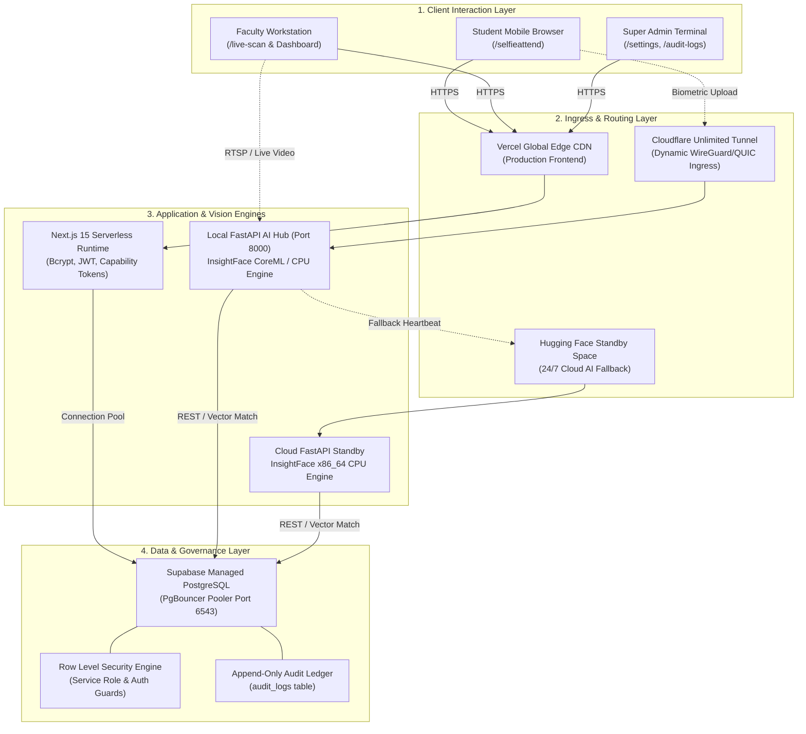
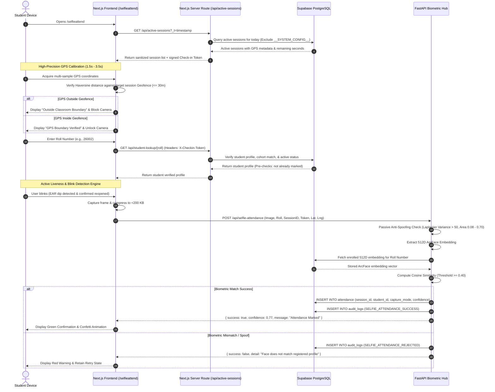

# 🌐 System Topology & End-to-End Data Flow
**Architecture Specification Document • Ref: MEDATTEND-ARCH-001**

---

## 1. Ecosystem Component Overview

The MedAttend AI attendance ecosystem is structured across four decoupled, high-resilience layers:

---

## 2. Component Specifications

### 2.1. Frontend Presentation Layer (Next.js 15)
- **Framework:** Next.js 15.2.4 (React 19.2.4, App Router, TypeScript 5).
- **Hosting Target:** Vercel Global Edge Network with zero cold-start delivery.
- **Portals Provided:**
  - `/selfieattend` — High-security student self-check-in with active blink detection, roll lookup, and geofence verification.
  - `/live-scan` — Multi-camera classroom AI attendance dashboard with live CCTV feeds and real-time face matching.
  - `/dashboard` & `/reports` — Academic year analytics, Excel export, and NMC compliance tracking.
  - `/audit-logs` — Immutable administrative forensic trail inspection.
- **Key Client Optimizations:**
  - Client-side canvas image compression (`compressImage`) reduces multi-megapixel camera snaps to `<200 KB` WebP/JPEG payloads before transit, enabling `<100ms` transmission even over weak 4G cellular links.
  - Font scaling enforced at `>=16px` on mobile input fields to prevent iOS Safari auto-zoom distortions.

### 2.2. Biometric Vision Engine (FastAPI + InsightFace)
- **Framework:** FastAPI running under Uvicorn ASGI server (Python 3.10+).
- **AI Models:**
  - **Face Detection:** InsightFace `buffalo_sc` (`det_500m.onnx`) operating with input resolution of `960x540` and detection threshold `0.15`.
  - **Recognition & Embeddings:** ArcFace `w600k_mbf.onnx` extracting 512-dimensional unit-norm mathematical vectors (`float32[512]`).
- **Acceleration Pipeline:**
  - **Local Mac (Primary):** `CoreMLExecutionProvider` delivering `40ms – 70ms` inference latency per face on Apple Silicon Neural Engines.
  - **Linux / Cloud (Fallback):** `CPUExecutionProvider` with optimized OpenMP multi-threading (`200ms – 350ms` per face).

### 2.3. Dual Ingress & 24/7 Tunnel Redundancy
1. **Accelerated Local Execution (Cloudflare Tunnel):**
   - Launched via `start.py` -> `start.sh` invoking bundled `cloudflared`.
   - Bypasses residential/campus NAT and CGNAT without port forwarding.
   - Updates `settings.tunnel_config` in Supabase with HMAC-SHA256 signature so Vercel dynamically discovers the active endpoint.
2. **24/7 Cloud Standby (Hugging Face Spaces):**
   - Hosted at `https://saiwebss-medattend-backend.hf.space`.
   - When the local MacBook is closed or offline, `stop.sh` or the Next.js backend proxy immediately routes attendance requests to Hugging Face, ensuring zero system downtime.

### 2.4. Persistence & Security Layer (Supabase PostgreSQL)
- **Instance Type:** Managed PostgreSQL with Supavisor / PgBouncer connection pooler on port `6543`.
- **Row Level Security (RLS):** All sensitive tables (`students`, `attendance`, `audit_logs`, `app_users`) enforce granular RLS policies.
- **Transaction Safety:** Rate-limiting functions execute with `pg_advisory_xact_lock` and strict `SET search_path = public, pg_temp` to prevent race conditions and search-path hijacking.

---

## 3. End-to-End Data Flow Sequence: Student Self-Attendance

---

## 4. Latency & Throughput Profile

| Operation | Typical Latency (Local Mac CoreML) | Typical Latency (Hugging Face Cloud) | SLA Target |
| :--- | :--- | :--- | :--- |
| **Page Load & Hydration** | `< 120 ms` | `< 120 ms` (Vercel Edge) | `< 500 ms` |
| **Active Session & GPS Sync** | `< 45 ms` | `< 85 ms` | `< 250 ms` |
| **Student Roll Verification** | `< 30 ms` | `< 50 ms` | `< 200 ms` |
| **Blink & Liveness Decision** | Real-time (`~16 ms` / 60 FPS) | Real-time (`~16 ms` / 60 FPS) | `< 33 ms` |
| **Image Compression & Upload** | `< 60 ms` | `< 120 ms` | `< 200 ms` |
| **AI Detection & Embedding** | **`40 ms – 70 ms`** | **`200 ms – 350 ms`** | `< 500 ms` |
| **Vector Dot-Product Similarity** | `< 1 ms` | `< 1 ms` | `< 5 ms` |
| **Database Write & Audit Log** | `< 15 ms` | `< 25 ms` | `< 100 ms` |
| **Total End-to-End Check-In** | **`~0.8 s – 1.2 s`** | **`~1.5 s – 2.2 s`** | **`< 3.0 s`** |

